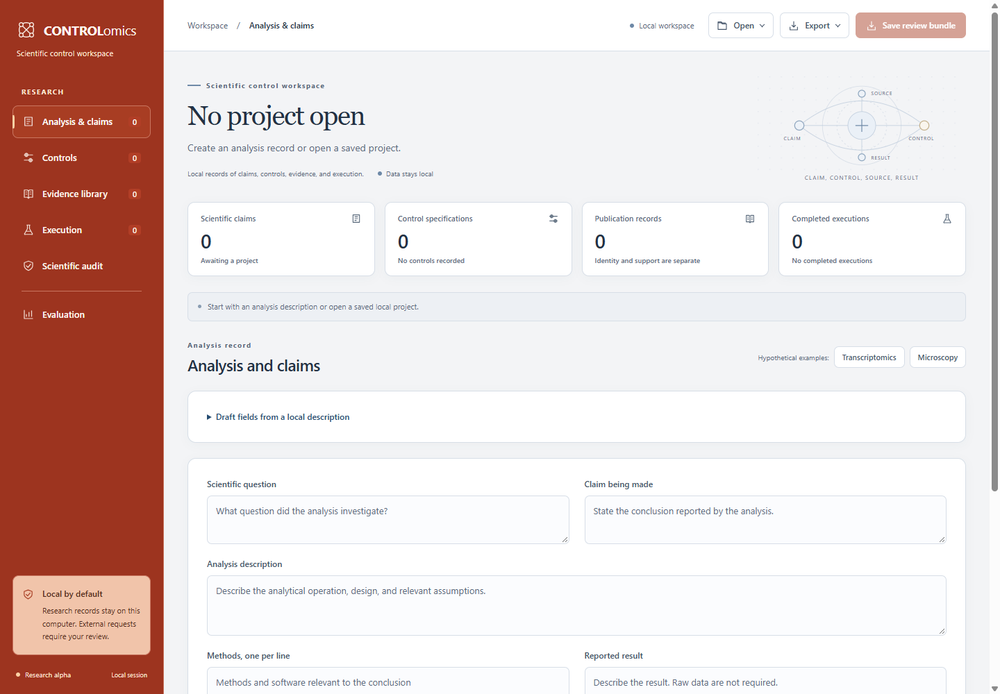

# Controlomics

Controlomics is a local research workspace for specifying, reviewing, executing, and auditing controls around computational biology claims. Primary analyses and raw datasets remain in the researcher's environment.

The research question is whether an evidence-grounded agent can derive scientifically appropriate controls across heterogeneous domains. Prototype validation assesses implemented contracts, numerical calculations, and synthetic workflows; these observations do not establish scientific suitability or generalization.

[The complete architecture walkthrough](docs/AGENT_ARCHITECTURE.md) maps the implemented components and their scientific and privacy boundaries. The default reasoner uses inspectable rules; an optional hosted model proposes candidates. Researchers review source support and decide what conclusions are justified.

## Working research alpha

Version `0.6.10.dev0` includes local description drafting, multiple claims, inspectable design rules, editable unreviewed controls, Europe PMC and Crossref retrieval, human statement and context review, local CSV inspection, independent-group technical references, complete-pair statistical execution, reproducible packages, linked scientific reports, and a six-section local workspace. A judgment workbench records supplied annotations and revision hashes. Review archives save and restore the project, report, network ledger, and optional evaluation together. Optional hosted reasoning uses a configurable chat-completion JSON interface. Project schema and ontology versions remain `0.1.0`.

Local exports preserve the previous file when an ordinary write or replacement fails. Evaluation reports identify their recorded source bundle by hash; replacing that bundle or selecting another partition clears stale metrics. Pending operations protect form inputs, and local session renewal retains the open workspace without automatically repeating a request.

Execution packages and restored review bundles prepare their complete contents before exposing a new directory. Choose a destination that does not already exist, including an empty directory. Fixed runners protect inputs and package files from conflicting output paths and stage result writes. The local server bounds connection workers and inactive reads; these controls do not qualify it for remote deployment.

The interface uses six sections with a Cinnabar navigation rail, warm ivory labels, burnt orange selected sections, and a responsive two-column control collection. The scientific overview and four record-count cards appear only in Analysis & claims; the other sections open at their own heading and content. Scientific audit assesses project claims, while Evaluation operates on supplied benchmark judgments and their recorded bundle. Burnt orange actions, warm ivory navigation text, slate record text, white surfaces, and restrained blue, ochre, and burgundy scientific states distinguish the interface elements. The overview retains the complete question and actual project and analysis identifiers; its conceptual scientific SVG is an illustration. Control specifications retain named fields for rationale, expected behavior, failure meaning, assumptions, and limitations. Search, class, claim, and evidence-state filters inspect the collection without changing it; Clear filters restores the complete collection. Results and audits retain the claim they challenge; execution details retain the control, assumptions, runner hash, and prespecified rule. Keyboard navigation, a mobile drawer, and reduced-motion support are included. See [the interface design](docs/INTERFACE.md).

Execution requires an explicit reviewed-control selection and explains missing prerequisites. Procedure inputs remain available while changing the control or refreshing the same project snapshot, so review them before another action. Editor, source-review, and judgment workbench actions focus their destination. The named external-request dialog initially focuses Cancel. The header retains a visible export-state label at narrow widths alongside the save-state live announcement.

Version 0.6.10.dev0 addresses prototype audit findings in review-state transitions, imported evidence gates, judgment missingness, Wilson boundaries, local execution budgets, privacy screening, server binding and response headers, claim-linked evidence, and lexical design cues. Existing hosted and researcher-drafted candidates remain unreviewed until an explicit review action. The Cinnabar interface and section-specific navigation are retained.

Prototype acceptance covers reproducible technical, synthetic numerical, interface, privacy, packaging, and AI-assisted reasoning checks. These checks do not establish biological efficacy, empirical control suitability, or cross-domain generalization. Earlier observations retain their original versions and source or artifact bindings.

The [current software suite](docs/validation/software_checks_audit_remediation_phase.json) passed 224 tests with zero failures, errors, or skips in 14.149 seconds including discovery and recording, on Windows CPython 3.14.0, Pydantic 2.12.4, and setuptools 83.0.0. [Current static checks](docs/validation/static_checks_audit_remediation_phase.json) passed seven check groups, including all 29 schema exports, Ruff 0.14.14, actionlint 1.7.12, Node 24.19.0 syntax checks, dependency consistency, and unchanged frozen numerical source hashes.

The [fresh offline numerical repetition](docs/validation/numeric_checks_audit_remediation_phase.json) matched all 896 scalar comparisons across 128 cases and reproduced every retained count across all 7,000 synthetic trials in 376.284 seconds. It used the unchanged frozen protocol and numerical sources with existing NumPy 2.4.6 and SciPy 1.18.1. Two zero-event Wilson endpoints now equal zero exactly; trial counts and point estimates are unchanged. Requested 95% percentile intervals still covered the null truth in only 74.1% to 93.9% of trials.

[Isolated Chrome 154 checks](docs/validation/ui_checks_audit_remediation_phase.json) and [Edge 155 checks](docs/validation/ui_edge_checks_audit_remediation_phase.json) each passed 84 real section-entry clicks across seven widths, 14 Home/End selections, and all nine judgment-state assertions. Untouched items were excluded from agreement; explicit uncertainty remained a nominal label. Each browser exercised four synthetic DEVELOPMENT_FIXTURE annotation submissions, not actual human reviews. Each record binds eight source hashes and 18 distinct current-phase capture hashes, preserving older screenshots. No JavaScript exception or external page request was observed.

The [remediation coverage record](docs/validation/audit_remediation_checks_audit_remediation_phase.json) identifies 15 fixed finding scopes and two documentation clarifications, with no unresolved defect in those inspected scopes.

Current [extracted-package checks](docs/validation/package_checks_audit_remediation_phase.json), [distribution checks](docs/validation/distribution_checks_audit_remediation_phase.json), [clean wheel installation](docs/validation/install_checks_audit_remediation_phase.json), and [clean source installation](docs/validation/sdist_install_checks_audit_remediation_phase.json) passed for their recorded artifact hashes, including actual synthetic fixed-runner execution. Clean installations used only local dependency wheels. The distributions retain the reviewed snapshot from before packaging records and final documentation links were added; the later complete source ZIP requires its own source binding. These developer remediation checks do not replace the original separate audit harness. Earlier records do not attest the changed runtime. No artifact has been published. See [the validation account](VALIDATION.md) for checked snapshots and retained failures.



The default reasoner adds operation-specific null, specificity, robustness, confounder, and falsification specifications when stated design cues apply. These are provisional review questions, with inspectable triggers and limitations. The original two-reference baseline remains available. Both abstain from choosing biological entities without reviewed evidence. METHOD_BASED is specification review, not empirical validation. Automatic method review applies only to newly created built-in local proposals. Existing hosted and researcher-drafted candidates require explicit review; loading, adding claims, and repeated analysis preserve their unreviewed state. Hosted candidates cannot supply citations or promote their evidence status.

## Start locally

Download or clone the source, open a terminal in its root, and use Python 3.11 or newer. No GitHub account, model subscription, API credential, or raw dataset is needed for the local synthetic demonstration. Select a Python 3 executable explicitly if your machine also has an older scientific installation.

On Windows:

```powershell
py -3 -m venv .venv
.\.venv\Scripts\python.exe -m pip install -r requirements-dev.lock
.\.venv\Scripts\python.exe -m pip install --no-build-isolation --no-deps .
.\.venv\Scripts\python.exe -m controlomics serve
```

On Linux or macOS:

```sh
python3 -m venv .venv
.venv/bin/python -m pip install -r requirements-dev.lock
.venv/bin/python -m pip install --no-build-isolation --no-deps .
.venv/bin/python -m controlomics serve
```

Open [the local workspace](http://127.0.0.1:8765). The [hypothetical transcriptomics demo](http://127.0.0.1:8765/#demo=transcriptomics) creates an example without provider requests. Windows users can subsequently start the installed environment with `Start_Controlomics.cmd`. Stop the server with Ctrl+C. Use `--port PORT` if the default port is occupied. Do not expose the server through a reverse proxy or public tunnel.

Follow [the usage guide](docs/USAGE.md) for retrieval, human review, execution, and model configuration. Projects stay in browser memory until exported. The workspace distinguishes recorded changes, unrecorded form inputs, and a prepared bundle download. Retain the downloaded file before closing; raw inputs and unrecorded edits are excluded. Opening another project or starting an empty workspace asks before replacing work. The generated demonstration report is `local_projects/demo/report.html`.

Execution offers an explicit local CSV inspection before computation. It checks columns, finite values, unit or pair structure, and limits, then shows dimensions and the SHA-256 of the original bytes. It performs no control execution or external request. The same check is available through `controlomics inspect-input FILE --adapter INDEPENDENT_REFERENCE --output SUMMARY.json`. A valid file shape does not establish sampling assumptions.

Review [the design rules](docs/DESIGN_RULES.md) and [evaluation protocol](docs/EVALUATION.md). Included benchmark judgment sheets are UNASSESSED; they deliberately yield no scientific recommendation-quality score. Development expectations and source motivation are distinct from independent expert annotations.

For development, install the package in editable mode and run the checks below. Use `.venv/bin/python` instead of the Windows executable path on Linux or macOS. Recorded local checks use CPython 3.14.0 on Windows; the configured GitHub matrix covers Python 3.11 to 3.14 on Windows and Linux, plus 3.14 on macOS. Those hosted jobs have not run before repository publication.

```powershell
.\.venv\Scripts\python.exe -m pip install --no-build-isolation --no-deps -e .
.\.venv\Scripts\python.exe -m controlomics validate examples/transcriptomics.project.json
.\.venv\Scripts\python.exe -m unittest discover -s tests -t . -v
.\.venv\Scripts\python.exe scripts/export_schemas.py --check
.\.venv\Scripts\python.exe scripts/check_release.py
```

Pydantic is the sole direct runtime dependency. No weights, GPU, database, containers, provider SDKs, or frontend build tools are required. Installation downloads public Python dependencies; ordinary local use and tests do not contact literature or model providers. The lock file records exact development versions without wheel hashes, rather than multi-platform qualification. See [CONTRIBUTING.md](CONTRIBUTING.md) for package checks and [the public release checklist](docs/PUBLIC_RELEASE.md) for the remaining release gates.

## Evidence, privacy, and limitations

Publication identity, statement support, context applicability, execution success, and claim validity are separate checks. Official metadata confirms recorded identities; human review supplies entailment attestations. Imported receipts and reviewer names are not authenticated proof. JSON Schema acceptance is structural; Python also checks relationships. See [the project format](docs/PROJECT_FORMAT.md) and [scientific specification](SCIENTIFIC_SPECIFICATION.md).

External requests require selected public fields and approval of the exact payload. Projects and raw inputs are never automatically serialized for providers. Credentials are excluded from previews, audit values, and reports. Pattern screening cannot identify every confidential fact. Review selected public fields and exports yourself. See [PRIVACY.md](PRIVACY.md) and [SECURITY.md](SECURITY.md).

Numeric execution supports reviewed technical positive and negative references using small independent-unit two-group calculations, permutation tests, and percentile bootstrap intervals. PASS and FAIL apply only to prespecified technical references. Inferential results receive no automatic scientific pass. A separate complete-pair mean-difference adapter requires an explicit specification and applicability rationale. It implements sign-flip permutation and whole-pair percentile bootstrap. Independence across pairs and sign invariance require justification. Other design challenges, biological controls, clustered and adjusted designs, and specialist primary analyses require applicable adapters.

Software tests, eight retained live identity checks, synthetic numerical observations, offline development comparisons, and interface review are recorded in [VALIDATION.md](VALIDATION.md). The six-case development fixtures test planted review-question codes. They are not an expert-grounded benchmark or evidence of agent generalization. A frozen [numerical validation study](docs/NUMERICAL_VALIDATION.md) matched 896 scalar comparisons against independently maintained SciPy across 128 cases. Its 7,000 synthetic trials revealed small-sample undercoverage: intervals requested at 95% covered the truth in 74.1% to 93.9% of trials. The [independent-study protocol](docs/INDEPENDENT_VALIDATION_PROTOCOL.md) separately describes a design for empirical scientific performance research. No live hosted model or biological control was evaluated. See [METHODS.md](METHODS.md) and [ROADMAP.md](ROADMAP.md).

## Citation and license

[The citation note](docs/CITATION.md) identifies the software without personal authorship metadata, a DOI, or a publication claim. The source is available under the owner-selected [MIT License](LICENSE). Its notice identifies the copyright holders collectively without disclosing personal names. Public bibliography and third-party dependencies retain their own attribution and terms. This local preparation does not publish a repository, release, package, or research artifact.
