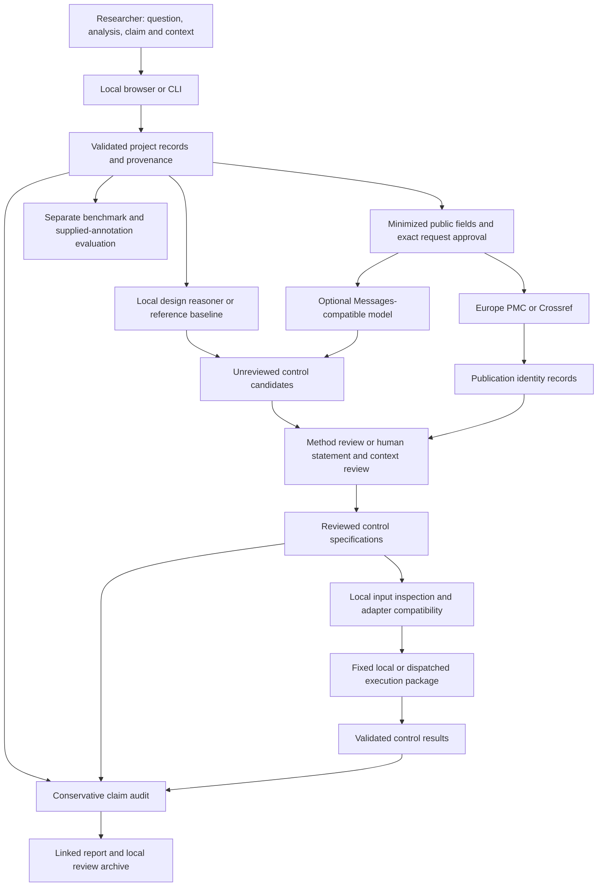

# Complete agent architecture

This describes the implemented local research alpha, version 0.6.1.dev0. Controlomics is a human-supervised scientific workflow with structured proposals, evidence review, restricted numerical tools, and conservative audits. Its default reasoning engine uses inspectable rules. An optional hosted language model can propose controls through the same record contracts. Scientific appropriateness and cross-domain generalization still require independent expert evaluation.

## Overall flow

The diagram shows available operations, not an automatic sequence that sends requests. The researcher chooses actions. External steps require their own exact-payload authorization; local work can run entirely offline.

## Components and responsibilities

| Component | Implementation | Input and output |
| --- | --- | --- |
| Browser workspace | `web/index.html`, `web/style.css`, `web/app.js` | Six views for analysis, controls, evidence, execution, assessment, and evaluation. Holds the current project, drafts, session token, request previews, and annotation work in memory. Sends explicit operations to the local server. |
| CLI and application entry | `cli.py`, `__main__.py`, `__init__.py` | Scriptable counterparts to intake, reasoning, review, execution, reporting, evaluation, archives, and local serving. Identifies the software version. |
| Loopback API | `server.py` | Binds to 127.0.0.1, serves fixed assets, validates bounded JSON, dispatches actions, and returns validated records. Mutating requests require the local Host, Origin, and session token. |
| Scientific record model | `schemas.py` | Strict, frozen Pydantic records for analyses, claims, context, candidates, reviewed controls, evidence, plans, results, audits, privacy, and provenance. Checks supported states and cross-record relationships. |
| Project parser and persistence | `project.py` | Rejects duplicate JSON keys, nonfinite numbers, unsupported fields, and oversized inputs. Loads and exports explicit local project snapshots and ten core JSON Schemas. |
| Auxiliary format contracts | `formats.py` | Exports nineteen workflow schemas, including proposals, reviews, execution configuration, annotation records, archives, and input summaries. Python also enforces relationships that structural schemas do not express. |
| Workflow coordinator | `workflow.py` | Creates projects and claims, records proposals and edits, applies review gates, imports evidence/results, and runs the claim audit. Returns replacement validated snapshots with provenance events. |
| Description drafting and design diagnosis | `reasoning.py` | Extracts explicitly labeled or stated phrases for researcher confirmation. Detects provisional analytical cues and emits inspectable review questions. Missing design information remains missing. |
| Local proposal engines | `MethodBaseline` and `DesignReasoner` in `models.py` | The reference baseline supplies known-signal and absent-signal technical specifications. The default design reasoner adds applicable null, specificity, robustness, confounder, and falsification specifications from stated operation cues. |
| Optional language-model adapter | `ModelProvider`, `MessagesProvider`, `DraftControl`, `Proposal` in `models.py` | Accepts selected public question, analysis summary, claim, method, and organism fields. Sends a constrained Messages-compatible request and validates JSON proposals. A proposal cannot supply verified evidence, citations, or runnable code. |
| Outbound privacy and transport | `privacy.py` | Screens and classifies selected fields, builds an exact request preview, checks its approval hash, restricts HTTPS/DNS/redirect behavior, bounds responses, separates credentials, and records request outcomes. |
| Literature identity layer | `evidence.py` | Europe PMC and Crossref search or identifier resolution. Preserves publication metadata, identifier aliases, response hashes, licensing notes, and identity receipts. Consolidates connected aliases while retaining warnings. |
| Local input inspection | `inputs.py` | Checks independent-group or complete-pair CSV structure, finite values, identifiers, dimensions, and original-byte SHA-256. Returns summaries without retained measurements or unit identifiers. Does not execute the control. |
| Execution planner and adapter gates | `execution.py` | Requires an eligible reviewed specification, assumptions, parameters, and applicability rationale where needed. Builds a fixed package with scripts, configuration, schema, hashes, project snapshot, and optional prespecified decision rule. |
| Numerical procedures | `statistics.py` | Independent-group mean differences, absolute-tail permutation tests, and percentile bootstrap; complete-pair mean differences, sign flips, and whole-pair bootstrap. Handles supported finite numeric scales and rejects unrepresentable effects. |
| Result verifier and importer | `execution.py` and packaged fixed scripts | Checks input/artifact integrity and result relationships to the planned control, execution identifier, rule, and runner hash. Imports results without treating a consistent record as authenticated external execution. |
| Scientific report | `reports.py` | Produces escaped standalone HTML with linked claims, specifications, evidence, results, rules, provenance, network ledger, and limitations. Labels interval coverage as requested coverage. Uses local styles and no scripts. |
| Review archive | `artifacts.py` | Packages project, generated report, minimized ledger, and optional evaluation/revision records with a hash manifest. Restores bounded archives in memory and rejects unsafe, duplicate, unsupported, or inconsistent members. |
| Benchmark and evaluation | `benchmark.py`, `evaluation.py` | Development findings, offline reasoner runs, partition/source checks, blank annotations, immutable prediction judgments, explicit metric denominators, uncertainty, abstention, and reviewer agreement. Unassessed judgments produce unavailable quality scores. |
| Scientific validation tools | `scripts/run_numerical_validation.py`, `scientific_reference.py`, `check_study_readiness.py` | Separately frozen synthetic experiments, optional SciPy comparisons, and local record-readiness checks. They provide evidence about calculations and record completeness, not independent expert truth. |
| Software verification and distribution | `tests/`, `scripts/export_schemas.py`, `check_package.py`, `check_ui.cjs`, lock files, `pyproject.toml` | Scientific consistency, privacy, adversarial, unit, CLI/HTTP, artifact, browser, schema, and wheel checks. These support software reliability within their stated scope. |

## The project is the agent's working memory

An `AnalysisContext` contains the scientific question, method description, observed result, biological context, and sampling/design assumptions. One analysis can have multiple `ScientificClaim` records. Every proposed control identifies the particular claim it challenges. Shared publication records do not erase that binding.

Control class and scientific level are separate. Classes are POSITIVE, NEGATIVE, NULL, SPECIFICITY, ROBUSTNESS, CONFOUNDER, and FALSIFICATION. Levels are TECHNICAL, STATISTICAL, BIOLOGICAL, and MECHANISTIC. A statistical null is not automatically an inactive biological entity.

The project stores candidates, reviewed controls, evidence, execution plans, results, audits, privacy policy, and timestamped provenance. Each action records relevant identifiers and, where applicable, versions, hashes, seeds, and limitations. IDs and hashes establish recorded relationships; they do not prove that a scientific statement is true.

The browser has no automatic persistent memory or project database. The CLI saves only when explicitly instructed. Researchers retain exports to continue work. Form signatures detect temporary edits; revision counters track whether a download was prepared. Neither feature proves that a downloaded file was actually saved.

## How reasoning works

The local description parser drafts fields from supplied text. Suggested claim categories still need confirmation; causal language does not establish causal support. The design rules look for prediction, comparison, association, ranking, overlap/enrichment, similarity, dependent units, temporal structure, batch structure, and causal interpretation.

These cues trigger questions about selection leakage, independent replication, exchangeability, background choice, confounding, matched reference selection, and alternative explanations. Recommendations retain their trigger, rationale, expected behavior, failure interpretation, method basis, priority, and uncertainty. The rules do not select empirically validated biological entities from text alone.

The optional model interface shares these constrained output records. Its fixed request uses temperature zero, a token budget of 3,000, and no streaming; these settings do not establish determinism or correct reasoning. Model health is recorded as configured and untested. A completed live model benchmark has not been performed. The implementation does not contain an autonomous tool-selection/replanning loop, multiple collaborating agents, a vector database, or a trained local model.

## Evidence gates and scientific states

Publication identity, statement entailment, and context applicability are separate decisions. Retrieval confirms recorded identifiers and metadata; it does not establish that a paper supports a control.

Human review addresses the candidate's exact rationale and expected behavior using local source text, excerpts, locators, relationship labels, and context. Software checks excerpt presence and record relationships. Human attestations supply the scientific support judgment. The implemented evidence gate requires support for both exact statements, a context MATCH, and no contradiction to record EVIDENCE_BACKED. Mixed support and contradiction can yield CONFLICTING_EVIDENCE. Incomplete support or context yields INSUFFICIENT_EVIDENCE.

Method review can record METHOD_BASED specifications without claiming empirical biological validation. `VerifiedControl` means a review record exists, including unsuccessful reviews. Candidate edits cannot overwrite reviewed specifications; source re-review must identify the current reviewed snapshot. Reviewer identifiers and attestations do not authenticate identity, expertise, or independence.

## Execution and interpretation

The independent-group adapter accepts supported technical positive/negative references. The complete-pair adapter accepts its explicitly specified statistical null and an applicability rationale. General design questions, clustered or adjusted designs, and biological controls require suitable additional adapters.

Local execution first validates the selected bytes, then runs the fixed hash-checked template in an owned temporary directory with explicit arguments and a timeout. A dispatched package supports execution in the researcher's environment and later result import. Model-generated prose never becomes executable code.

Technical PASS or FAIL requires an expected result and tolerance specified before execution. Permutation and bootstrap results remain INDETERMINATE for scientific pass/fail. Seeds, draw counts, input hashes, environment, method, effect, uncertainty, and warnings remain visible. Sampling independence, exchangeability, and sign invariance require scientific justification beyond file shape.

The current audit emits CONTROL_FAILURE if a relevant recorded technical control failed; otherwise it emits INSUFFICIENT_EVIDENCE. It also reports missing control classes, design concerns, causal overstatement, and context limitations. The schema offers richer future assessment categories, but the implemented audit does not automatically certify a claim as ROBUST.

## Privacy, artifacts, and trust boundaries

Projects and raw primary data remain local. Selected external fields must be explicitly SAFE, pass screening, and match the approved whole-request hash before transmission. Literature destinations are fixed provider routes; a model endpoint must pass the configured transport boundary. Credentials travel separately and do not enter previews, project exports, or reports. The ledger distinguishes NOT_STARTED, ATTEMPTED, and COMPLETED.

The loopback server serves fixed assets, uses bounded requests, disables request logging/caching, and checks Host/Origin/token on mutations. Browser text nodes and report escaping reduce imported-content execution. Local OS software and browser extensions remain outside the application's trust boundary.

`storage.py` stages explicit local exports beside their destination, flushes complete bytes, retains supported access restrictions, and replaces one file. Ordinary failures preserve earlier exports. CLI sidecars cannot alias each other or their protected inputs. See [security limits](../SECURITY.md) for supported permissions, rejected destinations, races, and the absence of a multi-file transaction. No automatic persistence is introduced.

Pending browser operations make form inputs inert. A rejected stale session can be renewed without a reload, while interrupted responses are never automatically replayed. Evaluation reports identify the complete recorded source bundle by hash, and replacing a bundle or selecting another partition invalidates displayed metrics. Whole-project parsing enforces the same single-result and runner-hash bindings as individual-result import. These checks preserve record consistency rather than authenticating execution or judgment.

Review archives exclude raw CSVs, full supplied source texts, authorization credentials, and outbound bodies. They can still contain confidential descriptions, excerpts, selected public queries, or reviewer identifiers. ZIP bounds and hashes check consistency, not authentic scientific provenance or anonymization. Researcher IDs can be pseudonymous; any real-identity mapping belongs in separately protected private records when the scientific study requires it.

## Evaluation and current validation

Evaluation keeps reference annotations, predictions, recommendation judgments, and evidence decisions separate. It checks declared partitions and source overlap, reports missing judgments, and computes conditional precision, critical/reference recall, unsupported rates, evidence-layer decisions, abstention, execution success, optional probability scores, and annotation agreement. Source semantics, contamination, and actual reviewer independence still need human curation.

The completed numerical phase matched 896 scalar comparisons across 128 synthetic cases against SciPy after explicit definition alignment. Seven scenarios used 7,000 total trials and revealed small-sample percentile undercoverage. See [numerical findings](NUMERICAL_VALIDATION.md). The existing six development cases remain unassessed. Independent expert control-selection validation remains pending; [the proposed study protocol](INDEPENDENT_VALIDATION_PROTOCOL.md) defines the actual case and annotation work required.

The application requires Python and Pydantic. The browser uses plain HTML, CSS, and JavaScript with local assets. Optional isolated NumPy/SciPy and existing Node/Chrome support development validation. Public hosting, remote multiuser operation, and hosted-model performance are not qualified by these local checks.
